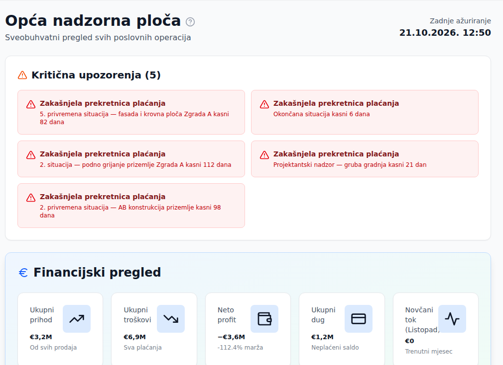

**Nadzorna ploča** je početna stranica sustava. Sadržaj se mijenja prema aktivnom **profilu**, ne prema ulozi (vidi [[switch-profile]]).

Naslovi po profilu:
- **General** — *Opća nadzorna ploča*
- **Sales** — *Prodajna nadzorna ploča*
- **Supervision** — *Nadzor gradilišta*
- **Funding** — *Investicijska nadzorna ploča* (s gumbom **Izvoz u PDF**)
- **Cashflow** — *Računovodstvena nadzorna ploča*
- **Retail** — *Retail nadzorna ploča*

Svaka verzija prikazuje pokazatelje svog područja — primjerice financije i projekte (General), prodaju i naplatu (Sales), stanje gradilišta (Supervision), kredite (Funding), novčani tok, firme i PDV (Cashflow).

Prodaja se prikazuje kroz dvije različite brojke, pa se ne moraju poklapati:

- **Ugovorena prodaja** (opća ploča, i stupac u tablici projekata) — vrijednost sklopljenih prodaja. Svaka prodaja vrijedi koliko paket: prodajna cijena stana i cjenik povezanih garaža i repozitorija. **Prosječna ugovorena cijena** dijeli tu vrijednost brojem prodaja; isti prosjek prodajna ploča prikazuje kao **Prosječna cijena prodaje**.
- **Naplaćeno od prodaje** (prodajna ploča) — uplate kupaca na račune za stanove.

Stopa prodaje na općoj ploči broji samo stanove (**Prodani stanovi**), a na prodajnoj sve jedinice — stanove, garaže i repozitorije. Stan označen kao prodan bez zapisa o prodaji broji se kao prodan, ali ne ulazi u ugovorenu prodaju.

Korisnici uloge **Supervision** ne vide nadzornu ploču — automatski se preusmjeravaju na [[site-management]]. Profil **Cashflow** dostupan je samo ulogama Director i Accounting i zahtijeva lozinku — pogledajte [[cashflow-unlock]].
